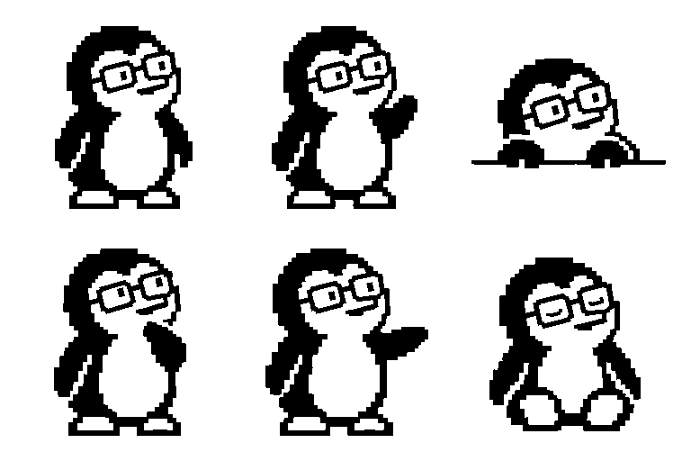
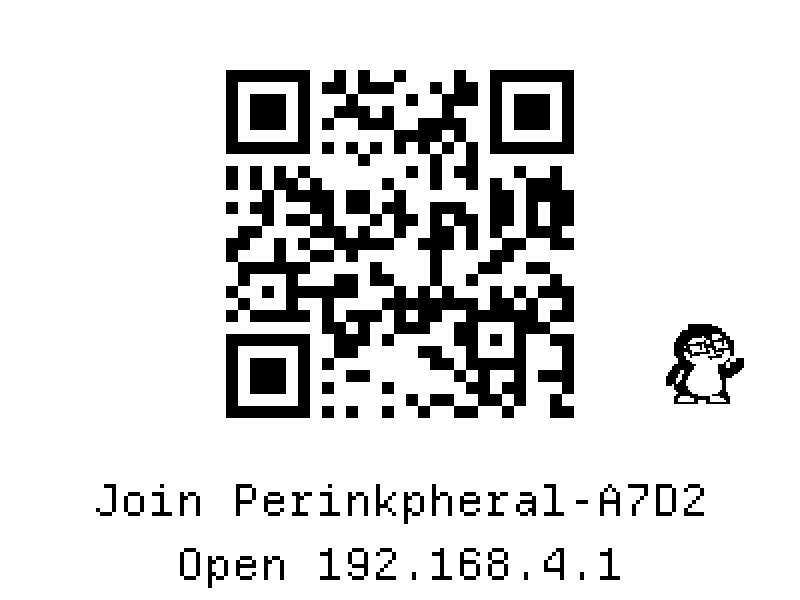
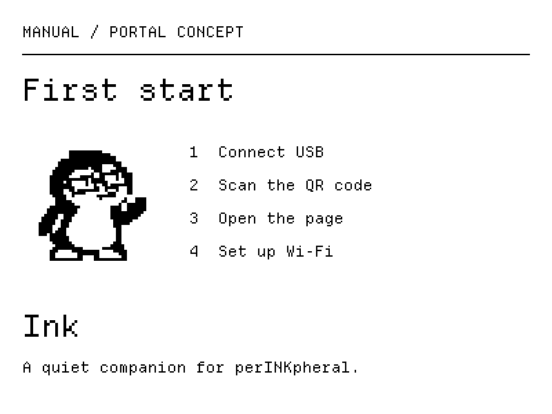

# Ink

Status: concept, not in version 1 (2026-11-23).

Ink is the project's mascot: a black-and-white penguin with glasses. The name comes from
perINKpheral; a penguin is the colour of ink.

The sheet has six poses: standing, waving, peeking over an edge, thinking, pointing, sitting.

## Placements

| Placement | Exposure | Cost |
|---|---|---|
| Portal and manual: an illustration beside the introduction | Read by choice | 0 bytes on the device; the 100 × 100 picture is 332 bytes as PNG |
| Wi-Fi setup screen: a 44 × 44 waving Ink at (330, 160), right of the QR code | First start, after a reset, explicit Wi-Fi setup | 266 bytes of picture data in the setup application's memory; no extra refresh, page or state |

 

The pictures for these placements: [44 × 44](ink/wave-44.png), [100 × 100](ink/wave-100.png).

A picture costs `height × ceil(width / 8)` bytes, plus 2 bytes in an application. Setup keeps the
QR code size, its text and its any-press exit; the QR code with its quiet zone ends at x = 314.

## Rules

- Ink is drawn with the frame that is already drawn. No refresh of his own, no animation, no
  pose that changes over time.
- No presses, secret combinations, random or timed appearances, celebrations, needs or
  notifications.
- No speech. The interface copy stays short and standard; the screen means the same without
  the picture.
- On the web, a decorative Ink has empty alternative text; a caption names him where he is the
  subject.
- Ink stays out of `gfx_icon_art.c` and the wordmark (`sys_draw_logo`).

## Rejected placements

| Placement | Reason |
|---|---|
| Splash, About | The splash is the wordmark only; About is diagnostics |
| Menu, empty lists, Settings | Empty space is not a reason |
| "Not set up", offline | The remedy is the content; Wi-Fi may be off on purpose |
| Errors, crashes, recovery, updates, flasher results | Diagnosis, consent and instructions come first |
| Notifications, idle screens | The screen belongs to the user's applications |
| A pet in the OS (moods, reactions) | Contradicts "peripheral, not a monitor" |

## A virtual-pet application

A catalog application in the manner of Flipper Zero's dolphin: Ink's mood or progress follows
the device's use. Notes from a legal review (2026-11-23, not legal advice):

- "Tamagotchi" is a Bandai trademark in the EU, US, Russia and Japan, software included. It
  must not appear in the name, icon, description or keywords; the term is "virtual pet".
- Mechanics (hunger, mood, care, growth) are not protected; code, sprites, sounds and text are.
  Nothing is copied, including ROMs and emulators (TamaLIB is GPLv2).
- No egg-shaped shell with its button layout; an EU shape mark exists since 2025.
- Bandai's patent US12102927B2 (2024) covers a wearable with heart-rate and movement input; a
  desk application without them is outside it. A commercial product needs its own clearance.
- Ink differs from Tux, Pingu and Club Penguin by the glasses, proportions and pixel style; their
  names, poses and settings are not used. Tencent holds penguin marks for software.
- Suggested name: "Ink Companion". Artwork carries an explicit licence and author.
